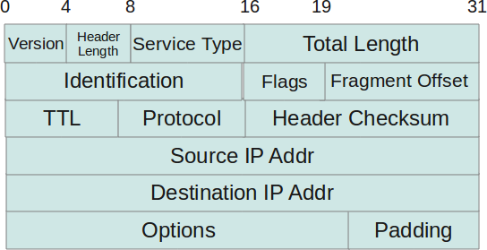

# MP Assignment: I Think I Shall Never See, a Poem as Lovely as in Binary Form

## Contents

- [General Description](#general-description)
- [Packet Description](#packet-description)
- [Checksum Algorithm](#checksum-algorithm)
- [Sample Packet](#sample-packet)
- [Implementation](#implementation)
- [Caveats](#caveats)

## General Description

When data is sent over the internet (movies, images, PDFs, emails, etc.), it is sent as a series of **packets**: the data is broken down into parts of a certain size. Each packet contains information such as the source address, destination address, length of the data, and the data itself. The header information of a real packet looks like this:



Read more about the packet header at <http://www.thegeekstuff.com/2012/03/ip-protocol-header/>.

For this MP Assignment, you are to **reconstruct packets "sent" into the actual readable message**. The packets are sent in binary format.

## Packet Description

This is a simple simulation, so the packets do not contain all the information found in an actual packet. The data part of each packet contains **one line of a poem**. The title of the poem is also represented by a packet.

Below are 3 sample packets:

```
101011000110100101011001000101111011100101001011110100001001011100000000000000001010001011000000000000000100100001010100011011110010000001000001011101010111010001110101011011010110111000000000
00001111010110101111011110101110110000001000001000001010111011010000000000000000111001000001000000000000000100000100100101100110
1010110001101001010110010001011110111001010010111101000010010111111111111110100001110000101100100000000000000000
```

Each packet contains the following fields, in this order:

| Field | Size | Notes |
| --- | --- | --- |
| Source address | 32 bits | IPv4 address |
| Destination address | 32 bits | IPv4 address |
| Sequence number | 16 bits | Order of the line in the poem |
| Checksum | 16 bits | Used to detect corruption |
| Length of data | 16 bits | Length of the data part, in bits |
| Data | variable | One line of the poem, 8 bits per character (ASCII) |
| Padding | variable | Zeros, so the whole packet is divisible by 16 bits |

### Source and Destination Addresses

Both addresses are IPv4 addresses: 32-bit strings divided into 4 octets separated by dots. Each octet holds a value from 0 to 255 (8 bits, so the maximum is 2<sup>8</sup> − 1 = 255). Examples: `69.89.31.226` and `192.130.10.237`.

The source/destination pair determines which poem a packet belongs to. **All packets with the same source/destination pair belong to one poem.**

### Sequence Number

Data sent over the internet is broken into many packets, so the recipient needs a way to know which packets belong together and in what order. The sequence number is **16 bits** long and is used for reconstruction.

| Sequence number | Meaning |
| --- | --- |
| `0` | The packet carries the **title** of the poem |
| `1, 2, ...` | The lines of the poem, in order |
| Negative | The **end-of-poem** packet. Its absolute value is the total number of packets in the poem, including the title. |

For example, a sequence number of `-10` means the poem has 10 lines in total, including the title. This is especially useful for detecting missing packets or lines, and for detecting duplicates.

### Checksum

Packets can get corrupted in transit. A 0 might turn into a 1 or vice versa, or an entire chunk might be corrupted. To detect this, a **checksum** is used:

1. Before a packet is sent, its checksum is computed with some algorithm.
2. When the packet arrives, the receiver computes the checksum with the same algorithm.
3. If the computed and sent checksums match, no error occurred. If they differ, the packet was corrupted in transit.

### Length of Data

A 16-bit value giving the length of the data part **in bits**. This is why the size of the data part can vary.

### Data

The data is one line of a poem. Each letter, punctuation mark or space is transmitted as its ASCII code in binary (8 bits per character).

### Padding

The checksum algorithm divides the packet into equal 16-bit parts. Because the data length varies, the packet may not be divisible by 16, so it may have padding. The padding is a sequence of `0`s, just enough to make the packet length divisible by 16. **The padding is not part of the data.**

## Checksum Algorithm

Take the following packet:

```
1010110001101001010110010001011110111001010010111101000010010111111111111110100001110000101100100000000000000000
```

**Step 1.** Divide the packet into 16-bit sub-parts:

```
1010110001101001/0101100100010111/1011100101001011/1101000010010111/1111111111101000/0111000010110010/0000000000000000
```

**Step 2.** Set the checksum to zero before computing anything, and keep a copy of the original checksum. The checksum is computed on the packet with the checksum field set to 0.

```
1010110001101001/0101100100010111/1011100101001011/0000000000000000/1111111111101000/0111000010110010/0000000000000000
```

**Step 3.** Add the 16-bit sub-parts one after another. A sum can carry into a 17th bit, so use **17-bit numbers**.

Adding the first two sub-parts:

```
01010110001101001
00101100100010111
-----------------
10000010110000000
```

**Step 4.** If the sum overflows, remove the overflow bit (the most significant bit, keeping 17 bits) and add it back to the sum:

```
10000010110000000 - that is the overflow
00000010110000000 - removing the overflow (still 17 bits)

00000010110000000
00000000000000001 - the overflow addition
-----------------
00000010110000001 - the resulting sum
```

**Step 5.** Add this sum to the next 16-bit sub-part. Repeat until all sub-parts are added.

```
00000010110000001
01011100101001011 - third sub-part
-----------------
01011111011001100

01011111011001100
00000000000000000 - fourth sub-part (the checksum default value)
-----------------
01011111011001100

01011111011001100
01111111111101000 - fifth sub-part
-----------------
11011111010110100 - a carry overflow

01011111010110100
00000000000000001 - the overflow
-----------------
01011111010110101

01011111010110101
00111000010110010 - sixth sub-part
-----------------
10010111101100111 - a carry overflow

00010111101100111
00000000000000001 - the overflow
-----------------
00010111101101000

00010111101101000
00000000000000000 - seventh sub-part
-----------------
00010111101101000 - final sum
```

**Step 6.** Take the 1's complement of the final sum (only its 16 bits, excluding the overflow bit):

```
0010111101101000 - final sum
1101000010010111 - 1's complement

checksum --> 1101000010010111
```

**Step 7.** Compare the computed checksum with the transmitted checksum:

```
1101000010010111 - transmitted checksum, taken from the received packet
1101000010010111 - computed checksum
```

They match, so the packet is **not corrupted**. If they do not match, the packet is corrupted.

## Sample Packet

```
101011000110100101011001000101111011100101001011110100001001011100000000000000011011101000001101000000010011100001010011011001010110000101110011011011110110111000100000011011110110011000100000011011010110100101110011011101000111001100100000011000010110111001100100001000000110110101100101011011000110110001101111011101110010000001100110011100100111010101101001011101000110011001110101011011000110111001100101011100110111001100000000
```

Reading the packet from left to right:

| Field | Bits | Decoded value |
| --- | --- | --- |
| Source address (32 bits) | `10101100 01101001 01011001 00010111` | `172.105.89.23` |
| Destination address (32 bits) | `10111001 01001011 11010000 10010111` | `185.75.208.151` |
| Sequence number (16 bits) | `0000000000000001` | `1` (sequence numbers start at 0, the title packet) |
| Checksum (16 bits) | `1011101000001101` | Treated as `0` when computing the checksum |
| Length of data (16 bits) | `0000000100111000` | `312`, so the data part is 312 bits |
| Data (312 bits) | `01010011 01100101 ...` | One line of the poem, 8 bits per character |
| Padding (8 bits) | `00000000` | Padding only, not information. Makes the packet length divisible by 16. |

## Implementation

### Representation

A poem is divided into packets. Represent a poem as a **list of packets**, and the entire collection of poems as a **list of lists of packets**: `list< list<packets> >`.

You may use the available C++ libraries. `bitset` is especially useful.

### Input

The input is a **file** with one packet per line, written in binary. The lines are not necessarily in the order they appear in a poem.

The file is read through the console: the only input you read from the console is a **string with the name of the input file**.

### Output

The output is the reconstructed poems, displayed on the console.

For each poem:

1. Write the title.
2. On the next line, write the source/destination pair.
3. Write the lines of the poem.

The input may contain more than one poem. Write the poems **in the order they are found in the input file**. Poems are identified by their source/destination addresses, so take note of each new source/destination pair read from the file.

### Sample Output

```
To Autumn
172.105.89.23/185.75.208.151
Season of mists and mellow fruitfulness,
Close bosom-friend of the maturing sun;
Conspiring with him how to load and bless
With fruit the vines that round the thatch-eaves run;
To bend with apples the moss'd cottage-trees,
And fill all fruit with ripeness to the core;
To swell the gourd, and plump the hazel shells
With a sweet kernel; to set budding more,
And still more, later flowers for the bees,
Until they think warm days will never cease,
For Summer has o'er-brimm'd their clammy cells.
Who hath not seen thee oft amid thy store?
Sometimes whoever seeks abroad may find
Thee sitting careless on a granary floor,
Thy hair soft-lifted by the winnowing wind;
Or on a half-reap'd furrow sound asleep,
Drows'd with the fume of poppies, while thy hook
Spares the next swath and all its twined flowers:
And sometimes like a gleaner thou dost keep
Steady thy laden head across a brook;
Or by a cider-press, with patient look,
Thou watchest the last oozings hours by hours.
Where are the songs of Spring? Ay, where are they?

--------------------------------------------------------------------------------

If
15.90.247.174/192.130.10.237
If you can keep your head when all about you
Are losing theirs and blaming it on you,
If you can trust yourself when all men doubt you,
But make allowance for their doubting too;
If you can wait and not be tired by waiting,
Or being lied about, don't deal in lies,
Or being hated, don't give way to hating,
And yet don't look too good, nor talk too wise:
If you can dream — and not make dreams your master;
If you can think — and not make thoughts your aim;
If you can meet with Triumph and Disaster
And treat those two impostors just the same;
If you can bear to hear the truth you've spoken
Twisted by knaves to make a trap for fools,
Or watch the things you gave your life to, broken,
And stoop and build 'em up with worn-out tools:
If you can make one heap of all your winnings
And risk it on one turn of pitch-and-toss,
And lose, and start again at your beginnings
And never breathe a word about your loss;
If you can force your heart and nerve and sinew
To serve your turn long after they are gone,
And so hold on when there is nothing in you

--------------------------------------------------------------------------------

Sonnet 18
241.110.48.219/24.238.133.94
Shall I compare thee to a Summer's day?
Thou art more lovely and more temperate:
Rough winds do shake the darling buds of May,
And Summer's lease hath all too short a date:
Sometime too hot the eye of heaven shines,
And oft' is his gold complexion dimm'd;
And every fair from fair sometime declines,
By chance or nature's changing course untrimm'd:
But thy eternal Summer shall not fade
Nor lose possession of that fair thou owest;
Nor shall Death brag thou wanderest in his shade,
When in eternal lines to time thou growest:
So long as men can breathe, or eyes can see,
So long lives this, and this gives life to thee.

--------------------------------------------------------------------------------

Hope is the Thing With Feathers
182.168.190.168/225.180.61.240
Hope Is The Thing With Feathers
Hope is the thing with feathers
That perches in the soul,
And sings the tune without the words,
And never stops at all.
And sweetest in the gale is heard;
And sore must be the storm
That could abash the little bird
That kept so many warm.
I've heard it in the chilliest land
And on the strangest sea;
Yet, never, in extremity,
It asked a crumb of me.

--------------------------------------------------------------------------------

Sunset
137.51.74.118/71.125.44.47
Slowly the west reaches for clothes of new colors
which it passes to a row of ancient trees.
You look, and soon these two worlds both leave you
one part climbs toward heaven, one sinks to earth.
leaving you, not really belonging to either,
not so hopelessly dark as that house that is silent,
not so unswervingly given to the eternal as that thing
that turns to a star each night and climbs--
leaving you (it is impossible to untangle the threads)
your own life, timid and standing high and growing,
so that, sometimes blocked in, sometimes reaching out,
one moment your life is a stone in you, and the next, a star.
```

## Caveats

In transmitting the packets, it cannot be avoided that some packets:

- **Will be missing** (failed to reach the recipient).
  - Missing packets or lines must be shown in the output as `[line missing]`.
  - If the title is not received, show `[title missing]`.
- **Will be received more than once** (duplicate packets).
  - Make sure duplicate packets or lines are removed from the list of packets.
- **Will be corrupted.**
  - Corrupted packets or lines must be shown in the output as `[line corrupted]`.
